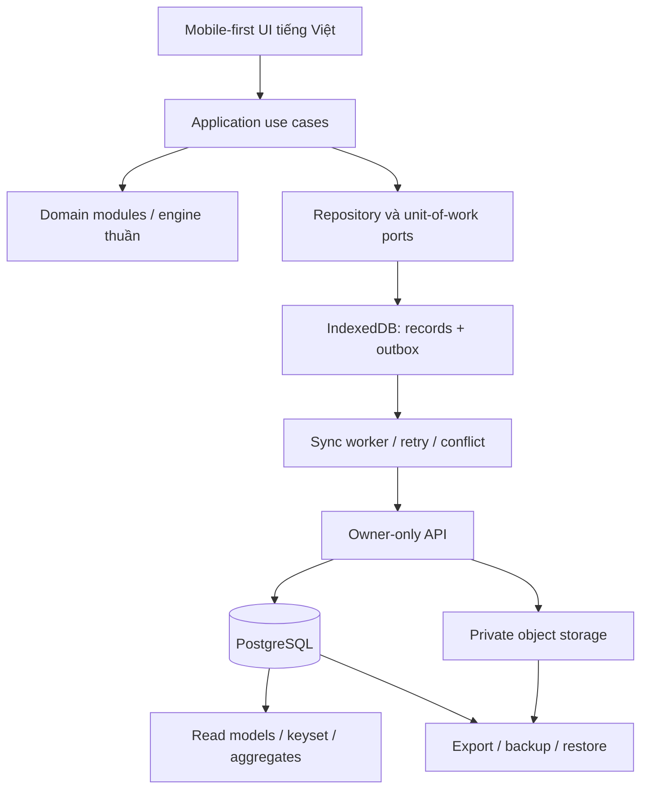

# 03 — Kiến trúc hệ thống (PROPOSED)

CP-001 thực thi trong ChatGPT Chat, độc lập với cuộc trò chuyện điều phối. Một modular monolith, một chủ sở hữu; không SaaS, không microservices. Các lớp dưới đây là thiết kế đích, không phải tính năng đang chạy.

**Đã viết:** `src/modules/{rice,farm-sales,expenses,land,finance,import}` xuất metadata boundary, `shared/contracts.ts` hợp đồng wire, `shell/routes.ts` routing thuần, UI native TS và React draft chia sẻ route. Không có logic nhập/chốt, persistence, API hoặc PWA. Giữ engine và domain không phụ thuộc UI/DB; module trao đổi qua use case/port và domain event, không viết trực tiếp bảng của nhau. Một transaction authoritative cho ghi nhận sự kiện và journal; read models không là nguồn giao dịch mới. Tách import staging khỏi posting. Báo cáo dùng source/revision/rule version.

## Offline & data ownership
- Service worker chỉ cache shell đã tải, versioned cache, cập nhật có kiểm soát không xóa dữ liệu; IndexedDB theo owner với transaction ghi entity + outbox trước thông báo lưu. Offline lần đầu chưa tải không được bảo đảm. Dexie đề xuất để đơn giản hóa transaction/schema; không cài trong CP-001.
- Mutation UUID ổn định qua retry, baseVersion, payload canonical hash, receipt unique theo owner/mutation; server atomic check/commit/receipt. Cùng key khác payload => conflict; ACK chỉ sau commit; retry exponential backoff/jitter, không retry vô hạn lỗi validation. Client giữ pending/acked/conflict, timestamp last sync và last backup riêng. Dữ liệu tiền/cân không silent last-write-wins. Xóa logic tombstone/revision có lý do, không xóa nguồn.
- Server derive owner từ phiên auth, không tin ownerId trong request. Owner-only, không public signup, TLS, scoped FK/RLS default deny, private object storage, size/type/checksum, URL ngắn hạn. Không ship service-role key. Local owner partition, khóa/đăng xuất phải bảo toàn bản ghi chưa sync, có cảnh báo export; không coi browser cache là bảo mật/backup tuyệt đối. Chưa có auth/RLS policies hoạt động; draft không cấp quyền client.
- Backup lossless JSON/CSV có manifest schema version, policy/revision, source metadata, SHA-256 từng file ảnh và dữ liệu; bảo vệ file backup, ít nhất một bản độc lập provider. Export local pending mutations riêng. Restore vào môi trường sạch, validate checksum/relations/counts/amounts/revision, không ghi đè production trước kiểm tra. RPO cloud 24h, RTO 4h chỉ là mục tiêu. Migration trước khi chạy phải backup và thử restore; chưa có rollback tự động.
- Import CSV/XLSX/JSON: preview → mapping version → validate từng dòng → dedup provenance+hash, kiểm tra overlap/full_total → owner xác nhận → transaction commit hoặc rollback batch qua revision/compensating event. Không đoán số thiếu, OCR chỉ gợi ý tương lai. Coverage tách verification và provenance; full_total liên kết detail, không cộng đôi, conflict chặn kết luận. Xem 04/05.

## Performance / autonomy
50 năm, 1M bao + 1M giao dịch + 10k metadata chứng từ là target, không hard cap. Ảnh object storage; chỉ tải theo nhu cầu. Index owner/date/ID, kỳ, source, land/activity; cursor keyset (date,id), batch/chunk import, server aggregation và virtualization. Benchmark synthetic 1k/100k/1M, p50/p95/error với thiết bị/cache/dataset/config, mục tiêu local write <=150ms, danh sách <=2s, dài hạn <=5s; chưa đo. Định kỳ đo dung lượng DB/index/object/backup/egress, không định mức tiền khi chưa có sizing/provider duyệt. Export portable tránh vendor lock-in; adapter auth/storage riêng. Không AI cho lõi.
