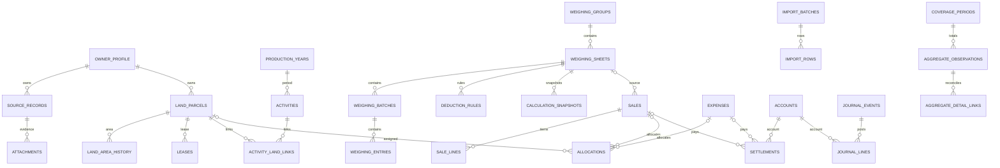

# 04 — Data model / ERD logic (PROPOSED)

SQL draft 42 bảng trong schema `snd`; không chạy PostgreSQL. Tất cả bảng con có composite PK `(owner_id,id)`, FK composite cho các quan hệ typed, timestamps/version. Owner root dùng `id` là scope. UUID do client sinh; chưa quy định UUID version. Business date là ngày địa phương, UTC timestamps kỹ thuật. `BIGINT` VND/gram và `NUMERIC` intermediate; bounds cuối cùng OPEN. `source_records` lưu nguồn bất biến theo contract, không đồng nghĩa đã có DB trigger.

Full inventory: `schema-tables.txt`, dictionary 11. `revisions`, `audit_events`, `sync_outbox`, `conflict_records` dùng polymorphic identity (`entity_type`, `entity_id`), cần whitelist/validation transaction; không có typed FK cho target trong draft. `sync_receipts` giữ mutation/hash/result_version. `report_snapshots` lưu basis/rule manifest; `assets/asset_valuations`, `loans/repayment_schedules`, `opening_balances/reconciliations/receivable_payable_links` phục vụ tài sản/nợ và đối chiếu. Source và financial rows có verification khi thích hợp; dòng phụ kế thừa nguồn từ aggregate.

## Invariants & migration gates
SQL có checks đơn giản: nonnegative, positive denominators, XOR sale/expense cho allocations, debit XOR credit, unique scope/ordinal/key, confirmed_zero requires confirmed. RLS enable+force và revoke PUBLIC; không policy allow, không mapping auth, superuser vẫn bypass — chưa là security proof. Bảng chưa có trigger cập nhật version/timestamps. Các trường JSON snapshot/raw phải có schema version, decimal string, size limit khi implement.

Chưa enforce cross-row: total allocations <= transaction; sale weight partition; bì không overlap và <= gross; batch thuộc đúng sheet của rule; journal event sum debit=credit, source uniqueness theo event semantics, posting/settlement atomic; no historical mutation; date/period required by event type; source/coverage overlap validation; idempotency payload mismatch; import rollback; confirmed data mới được post. Các lỗi này phải bị chặn ở domain/server transaction + DB constraints/triggers thích hợp trong CP sau. Draft có thể cần sửa fields, constraints, indexing và ledger mapping trước khi chạy. Không có policy rounding mặc định; `area_m2` nullable, rent nullable; coverage missing không thành zero.

Draft `BEGIN/COMMIT`, schema mới `snd`; không tự động chạy hoặc drop schema. Trước migration thực: dùng PostgreSQL local disposable, chạy fresh migrate, constraint/security tests, backup/restore; nếu fail sửa migration draft có version. Không dùng DB thật.
